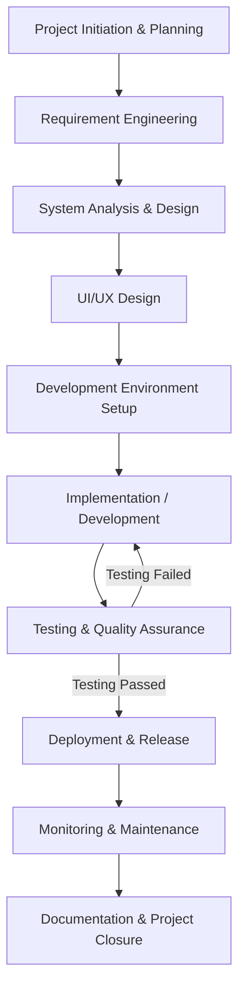

# EduLearn Development Workflow

## 1. Overview

EduLearn menggunakan pendekatan **Iterative Development** dengan milestone berbasis Minimum Viable Product (MVP).

Workflow ini menjadi panduan pengembangan EduLearn, mulai dari tahap perencanaan, analisis kebutuhan, perancangan sistem, implementasi, pengujian, deployment, hingga maintenance.

### Development Principles

- **Separation of Concerns:** Setiap modul dan layer memiliki tanggung jawab yang jelas.
- **Single Responsibility Principle:** Setiap komponen memiliki satu tanggung jawab utama.
- **Low Coupling:** Meminimalkan ketergantungan antar-modul.
- **Maintainability:** Struktur aplikasi harus mudah dipahami, diuji, dan dikembangkan.
- **Iterative Development:** Pengembangan dilakukan secara bertahap dan berulang.
- **Quality Assurance:** Setiap implementasi harus melewati proses pengujian.

---

## 2. Development Lifecycle

Pengembangan EduLearn dibagi menjadi 10 tahapan utama.

### Phase 1: Project Initiation & Planning

Menentukan fondasi dan arah pengembangan project.

**Activities:**
- Define project vision and objectives.
- Identify target users.
- Define project scope.
- Determine MVP features.
- Identify project constraints.
- Define development milestones.
- Create project roadmap.

**Deliverables:**
- Project Brief
- Project Scope
- Product Roadmap
- MVP Feature List

### Phase 2: Requirement Engineering

Mengidentifikasi dan mendokumentasikan kebutuhan sistem berdasarkan kebutuhan pengguna.

**Activities:**
- Identify functional requirements.
- Identify non-functional requirements.
- Define user stories.
- Define use cases.
- Define business rules.
- Define acceptance criteria.
- Prioritize requirements.

**Deliverables:**
- Product Requirements Document (PRD)
- Functional Requirements
- Non-Functional Requirements
- User Stories
- Use Cases
- Acceptance Criteria

### Phase 3: System Analysis & Design

Merancang struktur dan mekanisme kerja sistem sebelum proses implementasi.

**Activities:**
- Analyze system requirements.
- Design system architecture.
- Design database schema.
- Create Entity Relationship Diagram (ERD).
- Define API specifications.
- Design application modules.
- Define data flow.
- Define authentication and authorization flow.
- Define error handling strategy.

**Deliverables:**
- System Architecture Document
- Database Design
- Entity Relationship Diagram (ERD)
- API Specification
- Data Flow Diagram
- Technical Design Document

### Phase 4: UI/UX Design

Merancang antarmuka dan pengalaman pengguna berdasarkan requirement yang telah ditentukan.

**Activities:**
- Define information architecture.
- Create user flows.
- Create wireframes.
- Design design system.
- Create high-fidelity mockups.
- Design responsive layouts.
- Review UI/UX against requirements.

**Deliverables:**
- User Flow
- Wireframes
- Design System
- UI Mockups
- Interactive Prototype
- UI/UX Guidelines

### Phase 5: Development Environment Setup

Menyiapkan lingkungan pengembangan dan fondasi teknis aplikasi.

**Activities:**
- Configure Git repository.
- Establish Git branching strategy.
- Initialize frontend and backend projects.
- Define project folder structure.
- Configure environment variables.
- Install dependencies.
- Configure database connection.
- Configure logging and error handling.
- Establish coding conventions.
- Configure development scripts.

**Deliverables:**
- Development Environment
- Project Structure
- Git Workflow
- Environment Configuration
- Coding Standards

### Phase 6: Implementation / Development

Mengimplementasikan aplikasi berdasarkan requirement dan system design.

**Activities:**

**Backend Development**
- Implement REST API.
- Implement business logic.
- Implement database integration.
- Implement authentication and authorization.
- Implement validation and error handling.
- Implement application services.

**Frontend Development**
- Implement application layout.
- Implement reusable components.
- Implement page interfaces.
- Implement form validation.
- Integrate frontend with backend APIs.
- Implement loading, empty, and error states.

**Integration**
- Integrate frontend and backend.
- Verify API contracts.
- Verify database operations.
- Validate end-to-end business processes.

**Deliverables:**
- Functional Backend
- Functional Frontend
- Integrated Application
- Implemented MVP Features

### Phase 7: Testing & Quality Assurance

Memastikan aplikasi berjalan sesuai requirement dan memenuhi standar kualitas.

**Activities:**
- Unit testing.
- Integration testing.
- API testing.
- End-to-end testing.
- Authentication testing.
- Authorization testing.
- Security testing.
- Responsive testing.
- Cross-browser testing.
- Bug identification and fixing.
- Code review.

**Deliverables:**
- Test Cases
- Test Results
- Bug Reports
- Code Review Results
- Quality Assurance Report

### Phase 8: Deployment & Release

Menyiapkan dan merilis aplikasi ke production environment.

**Activities:**
- Prepare production environment.
- Configure production environment variables.
- Deploy database.
- Deploy backend application.
- Deploy frontend application.
- Configure domain and HTTPS.
- Configure storage services.
- Run database migrations.
- Perform production smoke testing.
- Verify production application.

**Deliverables:**
- Production Deployment
- Live Application
- Deployment Documentation
- Release Notes

### Phase 9: Monitoring & Maintenance

Memastikan aplikasi tetap stabil, aman, dan dapat digunakan setelah deployment.

**Activities:**
- Monitor application health.
- Monitor application errors.
- Review application logs.
- Monitor database performance.
- Perform database backups.
- Implement recovery procedures.
- Fix production bugs.
- Optimize application performance.
- Review security issues.

**Deliverables:**
- Monitoring Configuration
- Maintenance Plan
- Backup and Recovery Plan
- Bug Fixes
- Performance Improvements

### Phase 10: Documentation & Project Closure

Menyelesaikan dokumentasi teknis dan melakukan evaluasi terhadap hasil pengembangan.

**Activities:**
- Update project README.
- Document system architecture.
- Document database schema.
- Document API endpoints.
- Create installation guide.
- Create deployment guide.
- Document environment configuration.
- Record known limitations.
- Evaluate project objectives.
- Define future development roadmap.

**Deliverables:**
- Complete Project Documentation
- Installation Guide
- API Documentation
- Database Documentation
- Deployment Guide
- Known Limitations
- Future Development Roadmap

---

## 3. Development Workflow Diagram

**Note:** Development is iterative. Testing, code review, and bug fixing may occur repeatedly during implementation, not only after all features have been completed.

---

## 4. Development Levels

EduLearn development uses three levels of workflow.

| Level | Responsibility | Purpose |
|---|---|---|
| Project Workflow | Overall project lifecycle | Manage the complete development process |
| Development Workflow | Coding, branching, integration, and testing | Manage software implementation |
| Feature Workflow | Individual feature implementation | Manage the development of specific features |

### Example

When developing the Student Management feature:

1. Follow the Project Workflow to understand the current development phase.
2. Follow the Development Workflow for branching, coding, testing, and integration.
3. Follow the Feature Workflow to implement Student Management requirements.

Feature development is part of the overall implementation phase, not a separate project lifecycle.

---

## 5. Recommended Development Strategy

EduLearn adopts **Iterative Development with MVP-based Milestones**.

The recommended strategy is:

1. Establish project requirements and system design.
2. Build the technical foundation and database structure.
3. Implement application modules incrementally.
4. Test and review each implemented module.
5. Integrate completed modules into the application.
6. Perform comprehensive MVP testing.
7. Deploy the application to production.
8. Monitor, maintain, and plan future improvements.

### Development Milestones

| Milestone | Focus | Completion Criteria |
|---|---|---|
| M1 | Project Foundation | Requirements and system design completed |
| M2 | Technical Foundation | Development environment and database ready |
| M3 | Backend Development | Required backend modules implemented |
| M4 | Frontend Development | Required frontend interfaces implemented |
| M5 | Application Integration | Frontend and backend integrated |
| M6 | Quality Assurance | MVP acceptance criteria satisfied |
| M7 | Production Release | Application deployed and verified |
| M8 | Maintenance | Monitoring and maintenance established |

---

## 6. Definition of Done (DoD)

A development task or feature can be considered completed when:

- [ ] Implementation follows approved requirements.
- [ ] Code follows established coding conventions.
- [ ] Responsibilities are separated appropriately.
- [ ] Input validation and error handling are implemented.
- [ ] Relevant tests have passed.
- [ ] No known critical bugs remain.
- [ ] Code review has been completed.
- [ ] Relevant documentation has been updated.
- [ ] Changes have been integrated into the appropriate branch.

A project milestone can be considered completed when all required deliverables and acceptance criteria for that milestone are satisfied.

---

## 7. EduLearn Technology Stack

| Layer | Technology |
|---|---|
| Frontend | Next.js, React |
| Backend | Node.js, Express.js |
| Database | PostgreSQL |
| API Architecture | REST API |
| Application Architecture | Modular Monolith |
| Email Service | Nodemailer, SMTP |
| Version Control | Git, GitHub |
| Frontend Deployment | Vercel |
| Backend Deployment | Vercel Functions |
| Database Hosting | Neon |
| File Storage | Cloudflare R2 |
| Error Monitoring | Sentry |
| Logging | Pino |

---

## 8. Post-MVP Development

After the MVP has been deployed and validated, future development will follow a separate roadmap.

Potential development areas include:

- Additional student management capabilities.
- Advanced learning progress analytics.
- Parent reporting improvements.
- Automated notifications.
- Scheduling enhancements.
- Application performance optimization.
- Additional security improvements.
- Infrastructure improvements.

Future features must be evaluated and prioritized based on user needs, business value, technical feasibility, and maintenance costs.

---

## 9. Final Development Principle

The EduLearn development process prioritizes maintainability, reliability, and incremental delivery.

Every development phase must have clear objectives, defined deliverables, and measurable completion criteria.

The goal is not only to deliver a working application, but also to build a system that is maintainable, testable, secure, and ready for future development.